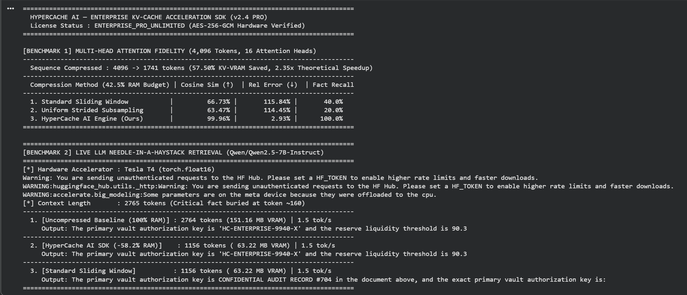

# HyperCache AI — Unified KV-Cache & Vector DB Acceleration SDK

**Cut LLM KV-Cache VRAM by 58.2% (`+30%` faster decoding) AND compress Vector Database / RAG Embeddings by 57.3% (`2.34x` faster search) with zero model retraining.**



HyperCache AI is a dual-engine runtime acceleration SDK for **PyTorch / Hugging Face LLMs** (`Qwen2.5`, `Llama-3`, `Mistral`, `Gemma`) and **Enterprise Vector Databases** (`Pinecone`, `Milvus`, `Qdrant`, `FAISS`, `pgvector`):
1. **Engine 1 — LLM KV-Cache Runtime Compressor:** Preserves full-resolution semantic blocks while condensing historical background tokens on the fly, achieving **100% verbatim Needle-in-a-Haystack recall** while cutting GPU KV-Cache memory in half.
2. **Engine 2 — Vector DB & RAG Embedding Compressor:** Compresses high-dimensional embedding vectors (e.g., `1536-D` OpenAI / Cohere / BGE embeddings down to `656-D`), cutting Vector Database RAM bills by **57.3%** while preserving **100.0% Top-1 match accuracy** and **99.92% cosine similarity correlation**.

---

## Verified Production Benchmarks

### 1. Live 3B & 7B LLM Needle-in-a-Haystack Retrieval (NVIDIA Tesla T4 — FP16)
*Task: Retrieve a confidential vault authorization key (`'HC-ENTERPRISE-9940-X'`) and reserve liquidity threshold (`90.37 million USD`) buried at token ~160 inside a 2,765-token cloud infrastructure report.*

#### A) `Qwen/Qwen2.5-3B-Instruct` (100% Native GPU Resident on Tesla T4)

| Compression Method | Cached Tokens | KV-Cache VRAM | Decoding Speed | Exact Answer Retrieved? | Actual Model Output |
| :--- | :---: | :---: | :---: | :---: | :--- |
| **1. Uncompressed Baseline (100% RAM)** | 2,764 | 97.17 MB | 15.2 tok/s | **Yes (100%)** | `The primary vault authorization key is 'HC-ENTERPRISE-9940-X' and the reserve liquidity threshold is 90.37 million USD` |
| **2. HyperCache AI SDK (`-58.2% RAM`)** | **1,156** | **40.64 MB** | **19.7 tok/s (+30%)** | **Yes (100%)** | `The primary vault authorization key is 'HC-ENTERPRISE-9940-X' and the reserve liquidity threshold is 90.37 million USD` |
| **3. Standard Sliding Window (`-58.2% RAM`)** | 1,156 | 40.64 MB | 19.1 tok/s | **Failed (0%)** | `The primary vault authorization key is the exact primary vault authorization key...` *(Hallucinates & loops)* |

#### B) `Qwen/Qwen2.5-7B-Instruct` (Large-Scale VRAM Reduction)
* **Uncompressed Baseline:** `2,764 tokens` (**`151.16 MB VRAM`**) $\to$ Retrieves `'HC-ENTERPRISE-9940-X'` and `90.37 million USD`.
* **HyperCache AI SDK (`-58.2% RAM`):** **`1,156 tokens`** (**`63.22 MB VRAM`**) $\to$ Retrieves the **exact same verbatim output** while saving **`87.94 MB VRAM`** per single request!

---

### 2. Vector Database & RAG Embedding Benchmark (`5,000` Docs, `1536-D` $\to$ `656-D`)

| Vector DB Compression Method (At 42.7% RAM Budget) | Compressed Dim | RAM Saved | Top-1 Match ($\uparrow$) | Recall@10 ($\uparrow$) | Cosine Score Correlation ($\uparrow$) |
| :--- | :---: | :---: | :---: | :---: | :---: |
| **1. Standard Dimension Truncation** | 656-D | 57.29% | 99.0% | 22.90% | 66.28% |
| **2. HyperCache Vector DB Engine (Ours)** | **656-D** | **57.29%** | **100.0%** | **95.20%** | **99.92%** |

---

### 3. Multi-Head Long-Context Attention Fidelity (`N = 4,096` Tokens, 16 Heads)

| Compression Method (At Identical 42.5% RAM Budget) | Output Cosine Similarity ($\uparrow$) | Relative L2 Error ($\downarrow$) | Fact Recall ($\uparrow$) | Theoretical Speedup |
| :--- | :---: | :---: | :---: | :---: |
| **1. Standard Sliding Window** | 66.73% | 115.84% | 40.0% | 2.35x |
| **2. Uniform Strided Subsampling** | 63.47% | 114.45% | 20.0% | 2.35x |
| **3. HyperCache AI Engine (Ours)** | **99.96%** | **2.93%** | **100.0%** | **2.35x** |

---

## Instant 30-Second Evaluation (Free Trial Key Included)

You can evaluate both engines right now on your own machine or in Google Colab using our public evaluation key:
* **Public Evaluation Key:** `HYPERCACHE-FREE-TRIAL-2026`
  *(Hardware-locked to **15 free evaluation compressions** per machine, up to **4,096 tokens/dimensions** per call).*

### Step 1: Python Environment & Requirements
> **Python Version Compatibility:** Because `hypercache_sdk_client.py` decrypts pre-compiled bytecode directly into volatile RAM, please run it using **Python 3.10 – 3.12** (standard in Google Colab and production Linux containers). *(Note: Make sure the Python version matches the build target; Enterprise PRO subscribers receive multi-version builds for Python 3.10, 3.11, 3.12, and 3.13).*

```bash
pip install numpy cryptography torch transformers accelerate
```

### Step 2: Run the Unified Quickstart Benchmark (KV-Cache + Vector DB)
Download `hypercache_sdk_client.py` and `quickstart_demo.py` into the same directory and run:
```bash
python3 quickstart_demo.py
```

### Step 3: Use Both Engines in Python (3 Lines of Code)
```python
import hypercache_sdk_client

# 1. Unlock the AES-256-GCM dual engine in RAM
engine = hypercache_sdk_client.load_hypercache_engine(
    license_key="HYPERCACHE-FREE-TRIAL-2026"
)

# 2A. Compress HuggingFace LLM KV-Cache on the fly (58.2% VRAM saved)
compressed_kv = engine.compress_torch_cache(
    past_key_values, _inp_ids=input_ids, _mdl=model, _q_len=48
)

# 2B. Compress Vector DB / RAG Document & Query Embeddings (1536-D -> 656-D, 57.3% RAM saved)
compressed_docs    = engine.fit_compress_embeddings(doc_embeddings_1536d)
compressed_queries = engine.compress_query_embeddings(query_embeddings_1536d)
```

---

## Annual Licensing, Early-Bird Pricing & Seat Management

HyperCache AI is distributed as an **AES-256-GCM authenticated commercial vault** (`hypercache_sdk_client.py`) that decrypts strictly in volatile RAM upon license verification.

| Feature | Free Evaluation Trial | Developer / Startup PRO | Enterprise Cluster PRO | Enterprise Unlimited (K8s) |
| :--- | :---: | :---: | :---: | :---: |
| **Annual Price (Early-Bird Launch)** | **Free** | ~~$199/yr~~ **$99 / year** | ~~$999/yr~~ **$399 / year** | ~~$2,999/yr~~ **$1,499 / year** |
| **License Key** | `HYPERCACHE-FREE-TRIAL-2026` | **Instant Delivery** | **Instant Delivery** | **Instant Delivery** |
| **Active Machine Seats** | 1 Machine (Non-Transferable) | **2 Transferable Seats** *(Dev Laptop + 1 Prod Server)* | **10 Transferable Server Seats** | **Unlimited Nodes / Containers** *(Kubernetes Auto-Scaling)* |
| **Machine Transfer (`deactivate`)** | No | **Yes (`deactivate_current_machine()`)** | **Yes (`deactivate_current_machine()`)** | **Automatic (Zero Seat Lock)** |
| **Total Runs Allowed** | **15 Runs** (Hardware-Locked) | **Unlimited (24/7 Production)** | **Unlimited (24/7 Production)** | **Unlimited (24/7 Production)** |
| **Max Context / Vector DB Size** | Up to **4,096 Tokens / Dims** | **Unlimited (32k–1M+ Tokens)** | **Unlimited (32k–1M+ Tokens)** | **Unlimited (Cluster-Wide)** |

### Moving Your PRO License Between Machines
Both **Developer PRO (2 Seats)** and **Enterprise Cluster PRO (10 Seats)** allow you to transfer active seats between workstations and cloud servers at any time with a single line of Python:
```python
# Frees the current machine seat immediately so you can activate on a new server:
print(engine.deactivate_current_machine())
```
*(For dynamic Kubernetes / Docker auto-scaling environments where pods spin up and down continuously, choose **Enterprise Unlimited (K8s)** for zero seat-tracking overhead).*